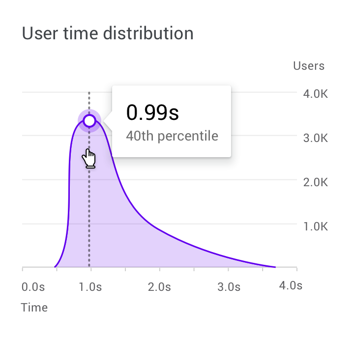
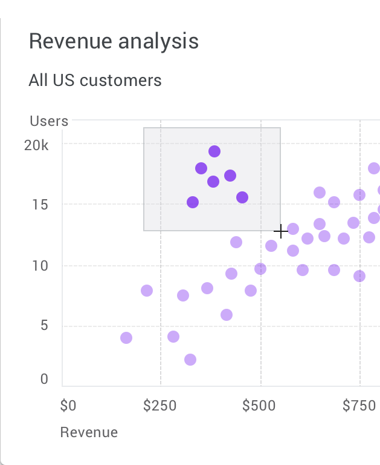

Interaktion
===========

Diagramme bieten Interaktionsmuster, die die Kontrolle über die angezeigten
Daten ermöglichen. Diese Muster ermöglichen es, sich auf bestimmte Werte oder
Bereiche eines Diagramms zu konzentrieren.

Die folgenden empfohlenen Interaktionsmuster, Stile und Effekte können das
Verständnis für die Diagrammdaten verbessern:

:ref:`progressive-disclosure` (schrittweise Offenlegung)
    bietet einen klaren Weg zur Enthüllung von Details, die bei Bedarf abgerufen
    werden können.
Direkte Manipulation
    ermöglicht, direkt auf UI-Elemente einzuwirken, wodurch die Anzahl der auf
    einem Bildschirm erforderlichen Aktionen minimiert wird, darunter
    :ref:`zoom` und :ref:`panning`, :ref:`pagination` und :ref:`data-controls`.
Perspektivwechsel
    erlauben, ein Design für verschiedene User und Datentypen einzusetzen,
    beispielsweise bei der Datensteuerung und Bewegungen.

.. _progressive-disclosure:

Progressive disclosure
----------------------

Diagrammdetails werden schrittweise offengelegt, wodurch User bei Bedarf
bestimmte Datenpunkte einsehen können.

   Durch Bewegen des Mauszeigers über ein Element oder durch eine *Tippen und
   Halten*-Geste auf Mobilgeräten wird ein Tooltip mit detaillierteren Daten
   über dem Diagramm angezeigt.

Filtern
-------

:ref:`zoom` und :ref:`panning` sind beliebte Interaktionsmöglichkeiten bei
Diagrammen, die beeinflussen, wie genau User Daten untersuchen und das
User-Interface des Diagramms erkunden können. Beide werden oft zusammen
verwendet.

.. _zoom:

Zoomen
~~~~~~

Durch das Zoomen wird die Darstellung der Benutzeroberfläche vergrößert oder
verkleinert.

Auf dem Desktop erfolgt das Zoomen durch Klicken und Ziehen oder durch Scrollen.
Auf Mobilgeräten erfolgt das Zoomen durch Auf- und Zuziehen mit zwei Fingern
oder durch Doppeltippen.

   Zoomen auf dem Desktop

.. _panning:

Verschieben
~~~~~~~~~~~

Durch das Verschieben können User das User-Interface erkunden, das über den
Bildschirm hinausgeht. Es sollte so eingeschränkt werden, dass es für die
angezeigten Daten sinnvoll ist, also :abbr:`z. B. (zum Beispiel)` nicht in die
Zukunft verschoben werden kann, für die weder Mess- noch Simulationsdaten
vorliegen.

.. _pagination:

Paginierung
~~~~~~~~~~~

Auf Mobilgeräten ist die Paginierung ein gängiges Muster, mit dem User durch
Wischen nach rechts oder links das vorherige :abbr:`bzw. (beziehungsweise)`
nächste Diagramm anzeigen können.

.. video:: pagination.mp4
   :autoplay:
   :caption: Auf Mobilgeräten können User nach rechts wischen, um den Vortag zu
             sehen.

.. _data-controls:

Datensteuerelemente
~~~~~~~~~~~~~~~~~~~

Daten können mithilfe von Wahlschaltern, Registerkarten und Dropdown-Menüs
gefiltert oder geändert werden. Diese Steuerelemente können zudem Kennzahlen
anzeigen, während User die Einstellungen anpassen.

.. video:: data-controls.mp4
   :autoplay:
   :caption: Mit Wahlschaltern, Registerkarten und Dropdown-Menüs lassen sich
             Daten ändern oder filtern.

Bewegung
~~~~~~~~

Bewegung kann die Beziehung zwischen Daten und der Art und Weise, wie User mit
ihnen interagieren, verbessern und verstärken. Motion sollte zweckmäßig und
nicht nur dekorativ eingesetzt werden, um :abbr:`z.B. (zum Beispiel)` Abläufe
zum Ausdruck zu bringen.

Bewegung sollte logisch, flüssig und reaktionsschnell wirken, ohne User bei
ihrer Navigation zu behindern.

.. seealso::
   * `pythreejs Animation
     <https://pyviz-tutorial.readthedocs.io/de/latest/js/pythreejs.html#Animation>`_
   * `ipyvolume Animationen
     <https://pyviz-tutorial.readthedocs.io/de/latest/js/ipyvolume.html#Animations>`_
